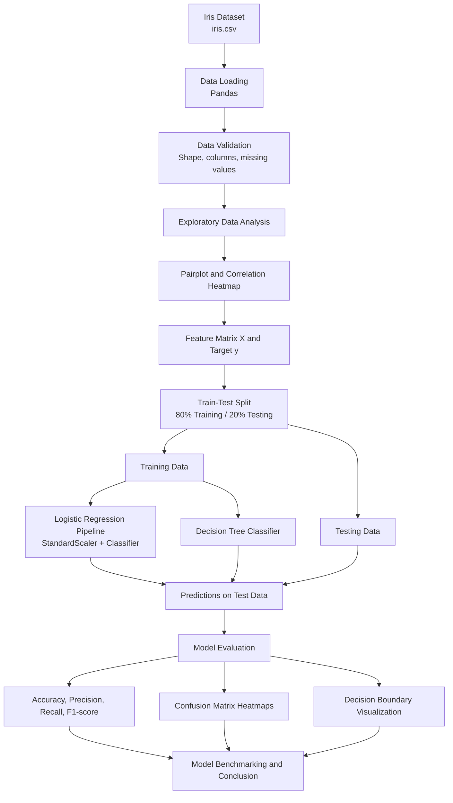

# 🌸 Iris Flower Classification | Machine Learning

<p align="center">
  
  
  
  
  
  
</p>

<p align="center">
  <b>A supervised machine learning project for classifying Iris flower species using Logistic Regression and Decision Tree classifiers.</b>
</p>

---

## 📌 Project Overview

This project implements an end-to-end supervised machine learning workflow to classify Iris flowers into three species: Setosa, Versicolor, and Virginica.

The workflow covers dataset validation, exploratory data analysis (EDA), feature preprocessing, model training, performance benchmarking, and visualization.

The objective is to compare two classification algorithms using consistent training and testing data and evaluate their performance using standard classification metrics.

## 🎯 Objectives

- Load and validate the Iris dataset.
- Perform exploratory data analysis using Pandas, Matplotlib, and Seaborn.
- Visualize feature relationships using pairplots and a correlation heatmap.
- Split the dataset into training and testing sets using an 80:20 ratio.
- Apply `StandardScaler` within a machine learning pipeline for Logistic Regression.
- Train Logistic Regression and Decision Tree classifiers.
- Benchmark accuracy, precision, recall, and F1-score.
- Visualize confusion matrices and two-feature decision boundaries.
- Document the complete workflow in a reproducible Jupyter Notebook.

## 🛠️ Technology Stack

| Technology | Purpose |
|---|---|
| Python | Core programming language |
| Pandas | Dataset loading, inspection, and tabular analysis |
| NumPy | Numerical computing |
| Matplotlib | Plotting and visualizations |
| Seaborn | Pairplots and statistical visualizations |
| Scikit-learn | Data splitting, preprocessing, model training, and evaluation |
| Jupyter Notebook | Interactive experimentation and documentation |

### Technology Logos

<p align="center">
  
  
  
  
  
  
</p>

*Logo images are externally hosted and may depend on their respective providers.*

## 🏗️ End-to-End Project Architecture



### Architecture Explanation

1. **Data ingestion:** Load the Iris CSV dataset using Pandas.
2. **Validation:** Inspect dataset dimensions, columns, data types, missing values, and target classes.
3. **EDA:** Explore feature distributions and relationships using pairplots and correlation analysis.
4. **Feature preparation:** Separate the four numerical input features from the species target.
5. **Train-test split:** Reserve 80% of samples for training and 20% for testing.
6. **Preprocessing and training:** Train Logistic Regression using `StandardScaler` in a pipeline and train a Decision Tree classifier.
7. **Evaluation:** Generate predictions on the held-out test set and calculate classification metrics.
8. **Visualization:** Display confusion matrices and decision boundaries based on petal length and petal width.
9. **Benchmarking:** Compare the two models and summarize their observed performance.

> **Implementation note:** The decision boundary plot uses two features so that the classification regions can be visualized in 2D. These visualization-specific models are separate from the full-feature models used in the primary benchmark.

## 📊 Dataset Details

| Property | Description |
|---|---|
| Dataset | Iris Flower Dataset |
| Total samples | 150 |
| Input features | 4 |
| Target classes | 3 |
| Training split | 80% — 120 samples |
| Testing split | 20% — 30 samples |

**Input features**
- Sepal length
- Sepal width
- Petal length
- Petal width

**Target classes**
- Iris-setosa
- Iris-versicolor
- Iris-virginica

## 🤖 Machine Learning Models

### 1. Logistic Regression

A supervised classification algorithm that estimates class probabilities. The workflow applies `StandardScaler` before fitting the classifier so that numerical features are standardized within the training pipeline.

### 2. Decision Tree Classifier

A supervised learning algorithm that learns feature-based decision rules to classify samples. It provides a second model for comparison against Logistic Regression.

Both models are evaluated on the same held-out test set.

## 📈 Model Benchmarking Results

The following scores were observed in the current notebook run.

| Metric | Logistic Regression | Decision Tree |
|---|---:|---:|
| Accuracy | 93.33% | 93.33% |
| Weighted Precision | 93.33% | 93.33% |
| Weighted Recall | 93.33% | 93.33% |
| Weighted F1-score | 93.33% | 93.33% |
| Correct test predictions | 28/30 | 28/30 |

### Results Interpretation

- Both models achieved identical aggregate scores on the current test split.
- Each model correctly classified 28 of the 30 test samples.
- The classification reports show perfect Setosa metrics on this test set.
- Versicolor and Virginica each achieved 0.90 precision, recall, and F1-score in the displayed reports.
- These results describe one train-test split and do not guarantee the same performance on unseen datasets.

## 📉 Visualizations

The notebook includes the following visual analysis:

| Visualization | Purpose |
|---|---|
| Seaborn pairplot | Explore relationships between numerical features and species |
| Correlation heatmap | Examine correlations among numerical features |
| Confusion matrix heatmaps | Inspect correct and incorrect class predictions |
| Decision boundary plots | Visualize class regions using petal length and petal width |

## 📁 Project Structure

```text
task-1-classification/
│
├── iris.csv
├── Tak-01_Formatted.ipynb
├── requirements.txt
├── README.md
└── .gitignore
```

The `task1/` virtual environment directory should remain local and should not be committed to GitHub.

## ⚙️ Installation and Execution

### Prerequisites

- Python 3.11
- Git
- Jupyter Notebook or Visual Studio Code with the Jupyter extension

### 1. Clone the repository

Replace the placeholder with your actual GitHub repository URL.

```bash
git clone <YOUR_GITHUB_REPOSITORY_URL>
cd task-1-classification
```

### 2. Create a virtual environment

**Windows PowerShell**

```powershell
python -m venv task1
.\task1\Scripts\Activate.ps1
```

### 3. Install dependencies

```bash
python -m pip install --upgrade pip
pip install -r requirements.txt
```

### 4. Launch the notebook

```bash
jupyter notebook
```

Open `Tak-01_Formatted.ipynb` and run the cells.

Ensure that `iris.csv` is located in the same directory as the notebook.

## 🔍 Evaluation Methodology

The project uses the following classification metrics:

- **Accuracy:** Proportion of correctly classified test samples.
- **Precision:** Proportion of predicted positives that are correct, calculated using weighted averaging.
- **Recall:** Proportion of actual samples correctly identified, calculated using weighted averaging.
- **F1-score:** Harmonic mean of precision and recall, calculated using weighted averaging.

The same test split is used for both models to support a consistent comparison. The notebook also includes class-wise classification reports and confusion matrices.

## 🚧 Limitations and Future Improvements

- Evaluate model stability using stratified cross-validation.
- Tune hyperparameters using a validation strategy.
- Compare macro-averaged and weighted classification metrics.
- Add reproducible random seeds and record package versions.
- Export the trained model and build a prediction interface as a future extension.

## ✅ Conclusion

This project demonstrates a complete classical machine learning classification workflow, from data exploration and preprocessing to model evaluation and visualization.

Logistic Regression and Decision Tree both achieved 93.33% accuracy and identical weighted precision, recall, and F1-score on the current 30-sample test set. Further validation would be needed to determine whether their performance generalizes across different data splits.

## 👨‍💻 Author

**Saad Asrar Momin**

- GitHub: [SAAD-MOMIN-37](https://github.com/SAAD-MOMIN-37)
- LinkedIn: [Saad Asrar Momin](https://www.linkedin.com/in/saad-asrar-momin/)

## 📌 Internship Task

**Datheon — Machine Learning & Data Science Internship**

Task 1: Iris Flower Classification

---

<p align="center">
  <i>Built with Python, Scikit-learn, Pandas, and Jupyter Notebook.</i>
</p>